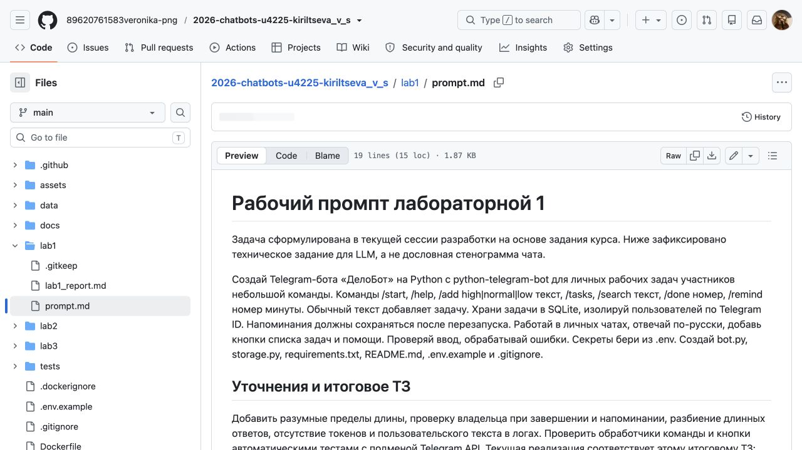
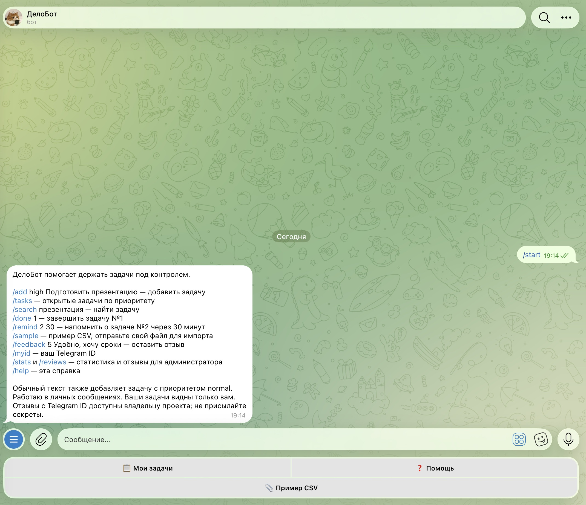
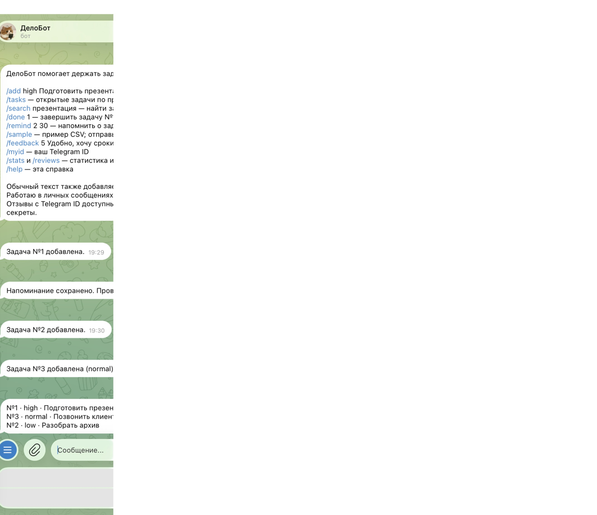

University: [ITMO University](https://itmo.ru/ru/)<br>
Faculty: [FICT](https://fict.itmo.ru)<br>
Course: [Vibe Coding: AI-боты для бизнеса](https://github.com/ex-itmo-ict-faculty/vibe-coding-for-business)<br>
Year: 2026<br>
Group: U4225<br>
Author: Кирильцева Вероника Сергеевна<br>
Lab: Lab1<br>
Date of create: 12.10.2026<br>
Date of finished: не защищена<br>

# Создание первого Telegram-бота без программирования

**Статус на 12.10.2026:** бот реализован, запущен и проверен в настоящем Telegram;
скриншоты приложены. Для полного выполнения остаётся видео-демо 2–3 минуты.

## 1. Цель и описание задачи

Цель — создать полезного бота с помощью естественного языка и LLM.
Выбран вариант **«Бот-ассистент для задач»**. Рабочие поручения теряются в переписке,
а сотруднику трудно быстро найти список и определить срочность. ДелоБот принимает
задачи, сортирует их по приоритету, завершает и напоминает о них в Telegram.
Этот вариант выбран за понятные сценарии и возможность проверить результат конкретными
действиями. Участники команды ведут личные списки; распределения задач между коллегами
в текущей версии нет.

## 2. Промпт для LLM и итерации

Разработка выполнена через LLM в Codex. Cursor установлен для работы с проектом,
но не заявляется как инструмент, которым был сгенерирован уже созданный код.

**Исходное рабочее ТЗ:** «Создай Telegram-бота ДелоБот на Python с python-telegram-bot
для личных рабочих задач. Добавь /start, /help, /add, /tasks, /search, /done и /remind.
Храни задачи в SQLite, отвечай по-русски, используй .env для токена».

**Уточнения:** изолировать пользователей по Telegram ID; проверять владельца задачи;
сохранять напоминания в базе; проверять длину текста и приоритет; добавить кнопки;
разбивать длинные ответы; не выводить секреты в логи.

**Финальный промпт:** исходное ТЗ вместе с перечисленными уточнениями и требованием
проверить команды и кнопки тестами с подменой Telegram API.
Полный [промпт и итоговое ТЗ](prompt.md) сохранены отдельно. Это техническое задание
текущей сессии разработки, а не дословная стенограмма всех сообщений.



*Рисунок 1 — рабочий промпт и уточнения сохранены вместе с проектом.*

## 3. Стек технологий

| Инструмент | Версия / назначение | Причина выбора |
| --- | --- | --- |
| Python | 3.12.14 локально | Подходит для Telegram-ботов и зависимостей |
| python-telegram-bot | 22.8, JobQueue | Команды, ответы, периодические напоминания |
| SQLite / sqlite3 | Встроенная база | Хранение без отдельного сервера |
| python-dotenv | 1.2.1 | Настройки из локального .env |
| unittest | Стандартная библиотека | Проверка логики без настоящего токена |
| Git / GitHub | Репозиторий и CI | История, отчёты, автоматические проверки |

## 4. Создание и реализация бота

Автор создала бота через BotFather: название **ДелоБот**, username **itmoftmi_kvs_bot**
соответствует инициалам Кирильцева Вероника Сергеевна. Токен сохранён в `.env`,
исключённом из Git. [Открыть бота](https://t.me/itmoftmi_kvs_bot).


*Рисунок 2 — профиль с названием и требуемым username. Переписки слева исключены из снимка.*

Файлы `bot.py`, `storage.py`, `requirements.txt`, `.env.example` и README созданы.
Задачи имеют текст, приоритет high/normal/low и статус. SQL использует параметры.
Обновление задачи выполняется по её номеру и ID владельца. Напоминания хранятся
в SQLite и проверяются каждые 30 секунд. Секреты и тексты переписки не записываются в логи.

Локальное окружение установлено командами:

```bash
python3.12 -m venv .venv
.venv/bin/python -m pip install -r requirements.txt
.venv/bin/python bot.py
```

На текущем Mac окружение создано на доступном Python 3.12; команда запуска та же.

## 5. Тестирование, скриншоты и видео

12.10.2026 выполнена настоящая проверка через Telegram-клиент и работающий бот.

| Проверка | Фактический результат |
| --- | --- |
| `/start` | Справка, команды и кнопки |
| `/add high Подготовить презентацию` | Добавлена задача №1 |
| `/add low Разобрать архив` | Добавлена задача №2 |
| Текст «Позвонить клиенту» | Добавлена задача №3 с normal |
| `/tasks` | Порядок №1 high → №3 normal → №2 low |
| `/search ПРЕЗЕНТАЦИЮ` | Найдена задача №1 без учёта регистра |
| `/remind 1 1` | Напоминание сохранено и доставлено в чат |
| `/done 2` | Задача завершена, исчезла из открытого списка |
| `/remind a b` | Понятное сообщение об ошибке числового ввода |
| Перезапуск процесса | Задачи сохранились, бот продолжил отвечать |



*Рисунок 3 — ответ на /start в настоящем Telegram.*



*Рисунок 4 — команды добавления и список, отсортированный по приоритету.*


*Рисунок 5 — найденная задача и фактически доставленное напоминание в 19:31.*


*Рисунок 6 — завершённая задача и открытый список после перезапуска в 19:33.*

11 автоматических тестов также проходят: изоляция пользователей, сохранение,
приоритеты, поиск, валидация, команды и кнопки. [Полный журнал](../docs/test-results.txt).
Скриншоты фиксируют действия текущей проверки, а не исторические действия,
для которых ранее не снимался экран.

**Видео-демо:** ещё не записано; ссылки на YouTube/Google Drive пока нет.
Подготовлен [сценарий на 2–3 минуты](../docs/demo.md). Скриншоты не заменяют видео.

## 6. Трудности и решения

Системный Python 3.9.6 не подходит закреплённым зависимостям — использовано окружение
Python 3.12.14. До появления токена логика проверялась тестами; после его сохранения
проверены настоящие сообщения. При проверке интерфейса Telegram координатные нажатия
были недоступны; ввод выполнен клавиатурой, ответы подтверждены снимками и SQLite.

## 7. Выводы

Создан работающий ассистент задач, подтверждены добавление, приоритеты, поиск,
завершение, напоминания и сохранение. Освоены постановка ТЗ для LLM, уточнение
требований и проверка результата. Хорошо работает короткий путь от сообщения до задачи.
Дальнейшее развитие — сроки и изменение приоритетов. Для полного закрытия lab1
требуется записать видео, добавить ссылку и защитить работу.
