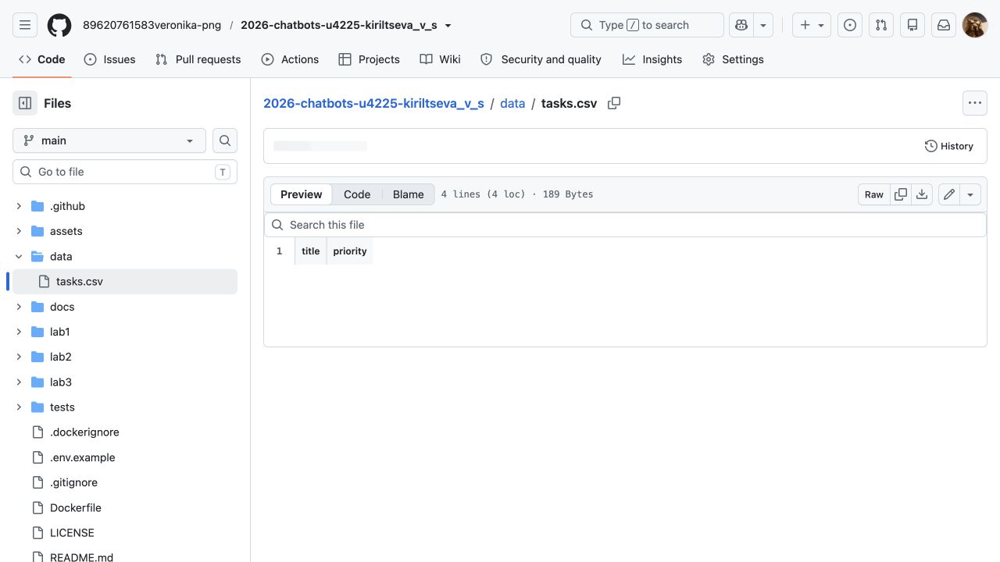
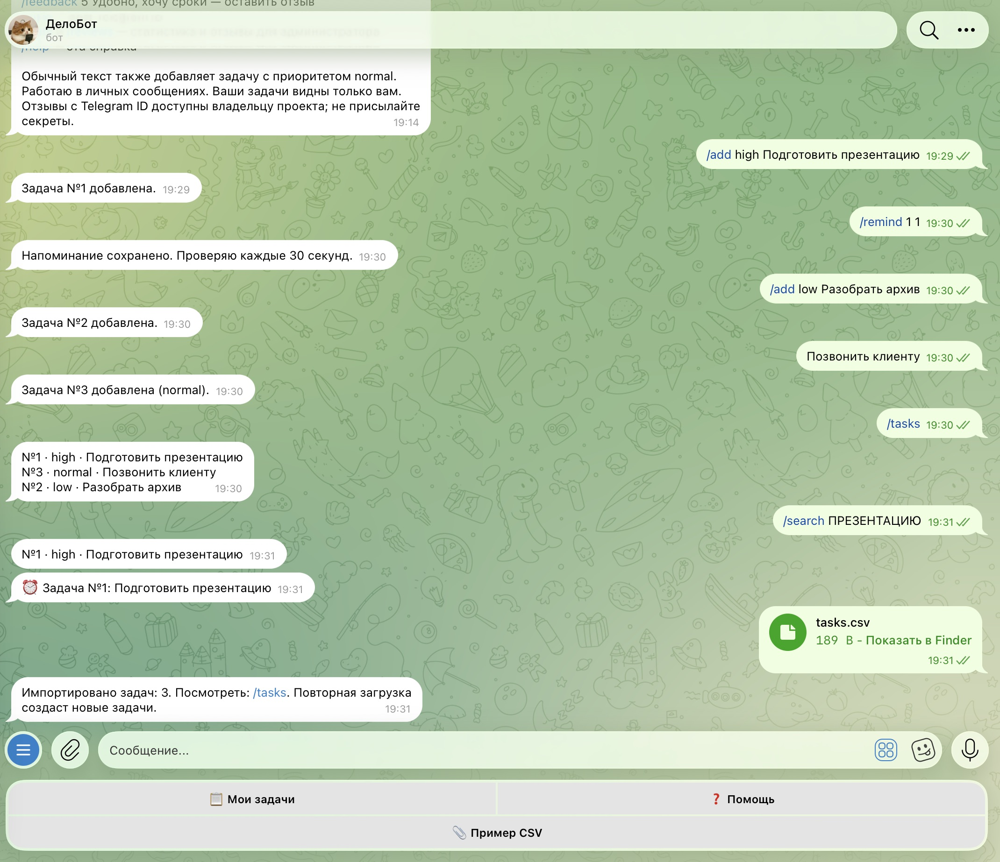
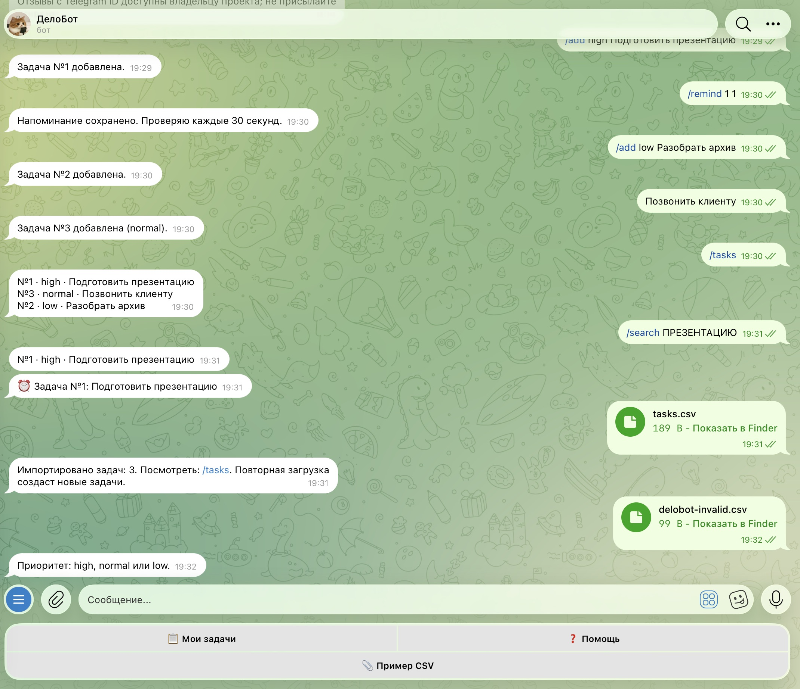
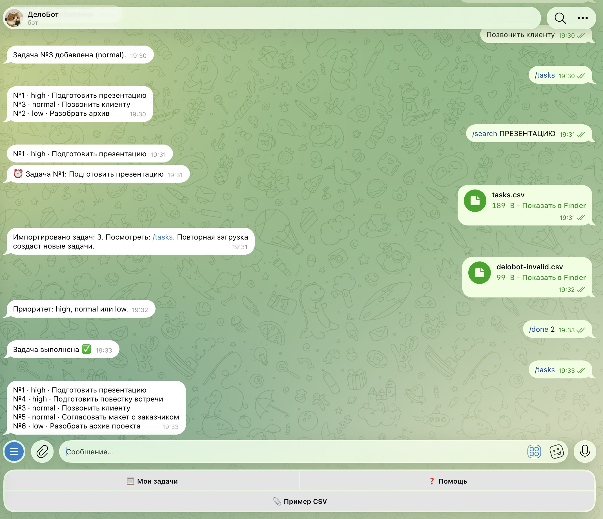
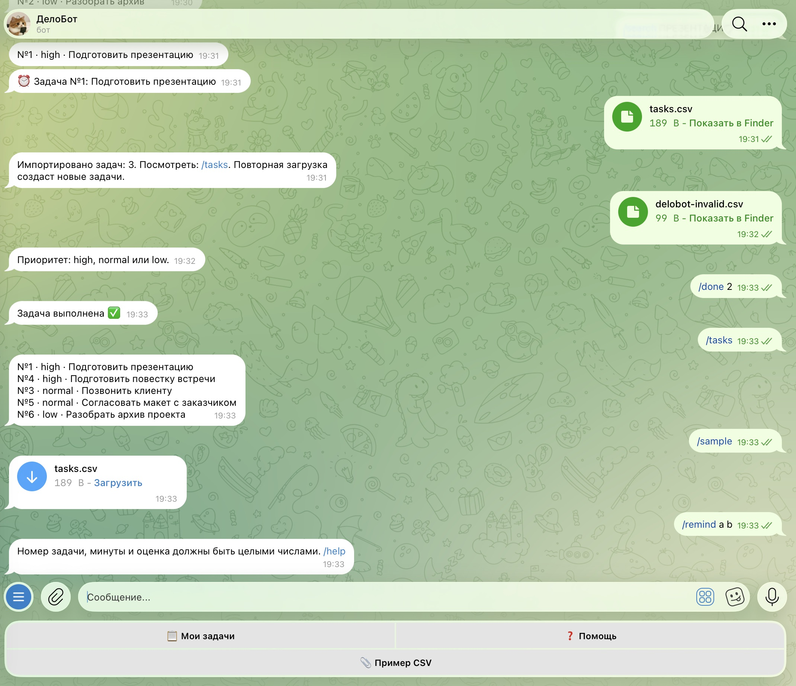

University: [ITMO University](https://itmo.ru/ru/)<br>
Faculty: [FICT](https://fict.itmo.ru)<br>
Course: [Vibe Coding: AI-боты для бизнеса](https://github.com/ex-itmo-ict-faculty/vibe-coding-for-business)<br>
Year: 2026<br>
Group: U4225<br>
Author: Кирильцева Вероника Сергеевна<br>
Lab: Lab2<br>
Date of create: 12.10.2026<br>
Date of finished: не защищена<br>

# Подключение бота к данным

**Статус на 12.10.2026:** CSV и SQLite реализованы и проверены в Telegram, включая
ошибочный файл и перезапуск; скриншоты приложены. Видео работы с данными ещё не записано.

## 1. Цель и описание интеграции

Цель — подключить бота к источникам данных через LLM-генерацию кода.
Выбраны **CSV-файлы и SQLite**. CSV позволяет менеджеру перенести список поручений
из таблицы, SQLite сохраняет задачи между запусками без внешнего сервера и API-ключей.
Публичный API не используется: по заданию достаточно одного типа интеграции.

Тестовый файл [data/tasks.csv](../data/tasks.csv):

```csv
title,priority
Подготовить повестку встречи,high
Согласовать макет с заказчиком,normal
Разобрать архив проекта,low
```

Это демонстрационные рабочие задачи, а не данные конкретной компании.



*Рисунок 1 — структура и строки выбранного источника данных.*

| Поля SQLite | Назначение |
| --- | --- |
| id, user_id | Номер задачи и владелец |
| title, priority | Текст и срочность |
| done, created_at | Выполнение и дата создания |
| remind_at, chat_id, reminded | Время, получатель и статус напоминания |

## 2. Промпт для LLM

**Исходное ТЗ:** «Улучши ДелоБота: добавь чтение CSV с колонками title,priority.
/sample присылает пример; пользователь загружает файл в чат; задачи сохраняются
в SQLite. Сохрани существующий функционал и обработай ошибки».

**Итерации:** поддержать UTF-8 BOM, проверить заголовок и число колонок, ограничить
размер 100 КБ и 100 задачами, проверить весь файл до записи и предупредить о повторном импорте.

**Финальный промпт:** исходное ТЗ с указанными ограничениями, атомарной транзакцией
и тестами успешного и ошибочного импорта, поиска и сохранения.
Полный [рабочий промпт](prompt.md) сохранён в репозитории; он описывает ТЗ текущей
сессии, не выдаётся за дословную стенограмму.

## 3. Реализация и библиотеки

Обработчик документа в `bot.py` проверяет расширение и размер, получает файл из
Telegram и вызывает `Storage.import_tasks`. Стандартные `csv` и `io` разбирают
UTF-8 CSV, `sqlite3` сохраняет строки. Дополнительные pandas или requests не нужны.

```python
rows = parse_csv(content)  # Сначала проверка всех строк.
with self.connect() as db:
    db.executemany('INSERT INTO tasks(user_id,title,priority) VALUES(?,?,?)',
                   [(user_id, title, priority) for title, priority in rows])
```

Проверка: точные колонки title,priority; непустой текст до 500 символов;
приоритет high/normal/low; кодировка; корректное число полей. Если любая строка
некорректна, весь импорт отклоняется. Данные изолированы по Telegram ID.
Поиск не учитывает регистр; формат ответа — номер, приоритет и текст.
Повторная загрузка создаёт новые задачи и не удаляет дубликаты.

## 4. Тестирование и примеры запросов

Проверка выполнена 12.10.2026 в настоящем Telegram.

| Действие | Фактический результат |
| --- | --- |
| `/sample` | Бот отправил tasks.csv, 189 байт |
| Отправка data/tasks.csv | «Импортировано задач: 3»; добавлены №4–6 |
| `/tasks` после загрузки | Видны импортированные и ранее созданные задачи |
| `/search ПРЕЗЕНТАЦИЮ` | Найдена задача, регистр не влияет |
| Ошибочный CSV: первая строка normal, вторая urgent | «Приоритет: high, normal или low» |
| Проверка SQLite после ошибочного CSV | По-прежнему 6 задач; первая строка ошибочного файла не записана |
| Остановка и повторный запуск процесса | 6 задач сохранены; №2 завершена; открытых задач 5 |



*Рисунок 2 — отправка CSV и фактический ответ успешного импорта.*



*Рисунок 3 — отклонение файла с неподдерживаемым приоритетом.*



*Рисунок 4 — сохранение данных, поиск и отображение задач после перезапуска.*



*Рисунок 5 — получение /sample и обработка некорректных числовых аргументов.*

Автоматические проверки также охватывают BOM, неверный заголовок, пустой файл,
плохую кодировку, лишние/недостающие колонки, атомарность импорта и изоляцию владельцев.
[Журнал 11 тестов](../docs/test-results.txt).

**Видео-демо:** ещё не записано, ссылки на видео нет.
[Сценарий демонстрации](../docs/demo.md) подготовлен; после записи ссылка добавляется сюда.

## 5. Трудности и решения

CSV из редакторов может иметь BOM и разное число колонок. Использован utf-8-sig и
явная проверка структуры. Чтобы исключить частичную загрузку, валидация вынесена перед
транзакцией. Для настоящей проверки файл отправлен через Finder и Telegram, ответ
сверен с количеством строк в SQLite. На некорректный файл бот отвечает без падения.

## 6. Выводы

Подключены два источника данных, подтверждены импорт, поиск, отображение, обработка
ошибок и сохранение после перезапуска. Освоены описание схемы данных для LLM,
проверка входных файлов и атомарная запись. Хорошо работает перенос небольшого списка
поручений из таблицы. Возможное развитие — предпросмотр и обнаружение дубликатов.
Для полного закрытия lab2 остаётся видео и защита.
