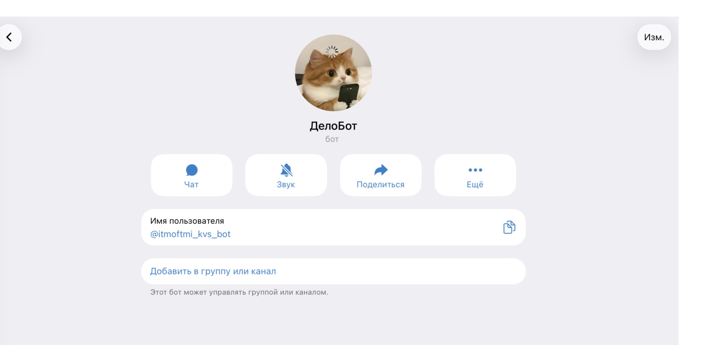
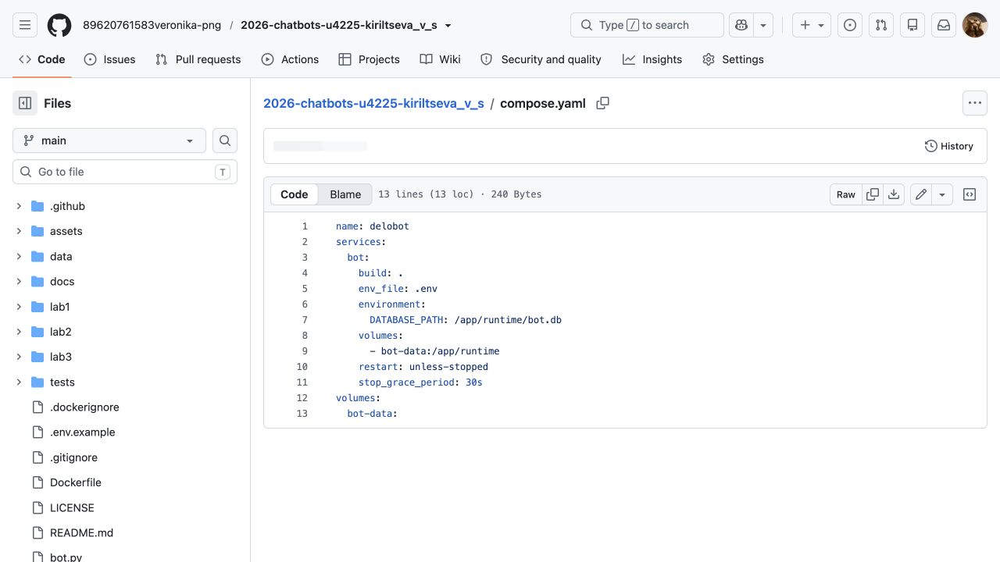
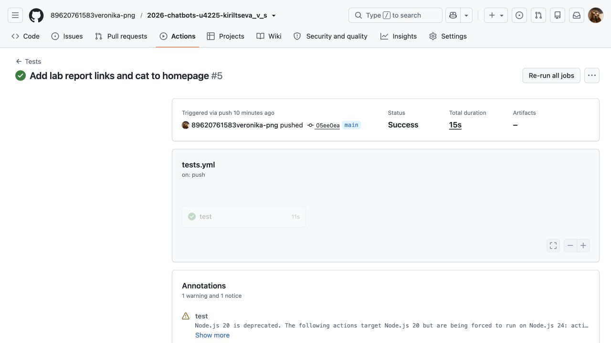
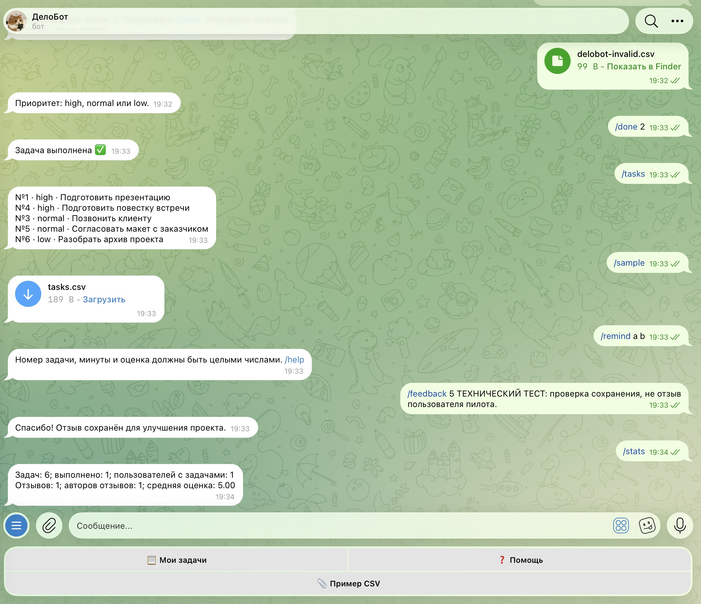
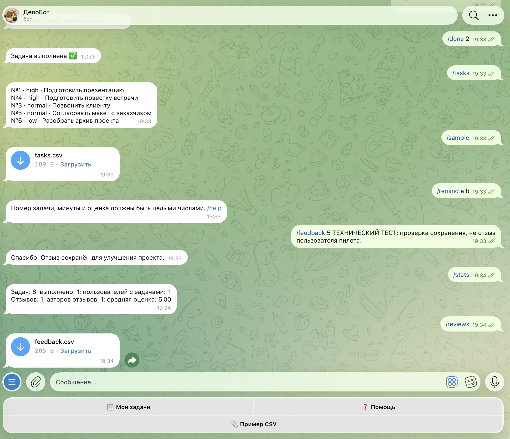

University: [ITMO University](https://itmo.ru/ru/) 
Faculty: [FICT](https://fict.itmo.ru) 
Course: [Vibe Coding: AI-боты для бизнеса](https://github.com/ex-itmo-ict-faculty/vibe-coding-for-business) 
Year: 2026 
Group: U4225 
Author: Кирильцева Вероника Сергеевна 
Lab: Lab3 
Date of create: 12.10.2026 
Date of finished: не защищена 

# Запуск бота для реального использования

**Статус на 12.10.2026: лабораторная выполнена частично.** Подтверждены локальный
запуск, реальные команды, перезапуск, сбор и экспорт тестового отзыва. Docker + VPS,
многодневное наблюдение, отзывы трёх реальных пользователей и улучшение по фидбеку
пока не выполнены. Наличие конфигурации не считается выполненным деплоем.

## 1. Цель и описание деплоя

Цель — обеспечить доступность бота, проверить его с реальными людьми и улучшить
продукт по отзывам. [URL бота](https://t.me/itmoftmi_kvs_bot).
Сейчас бот работает **локально на Mac автора через long polling**. Постоянный сервер
не предоставлен. Выбранный следующий способ — **Docker + VPS**: воспроизводимые
зависимости, постоянный том SQLite и автоматический перезапуск процесса.

*Рисунок 1 — созданный Telegram-бот; подтверждает его существование, не серверный деплой.*

## 2. Промпт для LLM

**Исходное ТЗ:** «Подготовь ДелоБота к Docker + VPS. Создай Dockerfile и compose.yaml
с перезапуском и постоянным томом. Добавь /feedback, /stats, /reviews и CI-тесты».

**Уточнения:** один процесс long polling; секреты из .env; запуск без root;
администратор задаётся через ADMIN_USER_ID; отдельный подсчёт отзывов и авторов;
защита CSV-экспорта от формул; резервная копия базы; отсутствие вымышленных отзывов.

**Финальный промпт:** исходное ТЗ с этими уточнениями и требованием подготовить
план пилота и отчёт со статусами. [Полный рабочий промпт](prompt.md) сохранён.

## 3. Процесс подготовки и локальная проверка

Выполнены установка Python-зависимостей, проверка .gitignore, сохранение токена в .env,
логирование без токена и текстов переписки, Dockerfile, Compose и GitHub Actions.
`docker compose config --quiet` успешно проверяет конфигурацию.

*Рисунок 2 — том bot-data и политика перезапуска; контейнер на VPS ещё не запускался.*

12.10.2026 приложение запущено в 19:11 по Москве. В 19:33 выполнены штатная остановка
и повторный запуск; данные сохранились. В Telegram подтверждены импорт, напоминание,
завершение задачи и последующие ответы. Это короткая функциональная проверка,
а не доказательство стабильности в течение нескольких дней.

*Рисунок 3 — CI со статусом Success; [ссылка на запуск](https://github.com/89620761583veronika-png/2026-chatbots-u4225-kiriltseva_v_s/actions/runs/38277212084).
CI проверяет код, а не доступность серверного процесса.*

Порядок серверного деплоя после получения VPS:

1. Клонировать репозиторий и создать закрытый .env с токеном и ADMIN_USER_ID.
2. Остановить локальный процесс; одновременно разрешён один экземпляр с токеном.
3. Запустить `docker compose up -d --build`.
4. Проверить `docker compose ps`, логи и команды в Telegram.
5. Перезапустить контейнер, проверить сохранение задач и напоминаний.
6. Наблюдать несколько дней, записывать доступность, ошибки и потребление памяти.

[Подробная инструкция и резервное копирование](../docs/deployment.md).
Публичный webhook и ngrok не требуются выбранному long polling.

## 4. Сбор обратной связи и статистика

Команда `/feedback оценка комментарий` сохраняет данные, `/stats` показывает сводку,
`/reviews` отправляет CSV. Последние две команды разрешены только владельцу,
настроенному локально через ADMIN_USER_ID. Telegram ID автора сохраняется —
опрос не анонимный, это объяснено в /start.

Для проверки механизма отправлен **один технический тест**, явно помеченный:
«ТЕХНИЧЕСКИЙ ТЕСТ: проверка сохранения, не отзыв пользователя пилота».
Оценка 5 использована как тестовый ввод; она не является оценкой полезности продукта.

*Рисунок 4 — сохранение технической записи и ответ /stats. Это не реальный пользовательский фидбек.*

*Рисунок 5 — владелец получил feedback.csv. Реальные идентификаторы из содержимого файла не публикуются.*

| Метрика на момент проверки | Результат |
| --- | --- |
| Пользователей с задачами | 1, аккаунт автора для технической проверки |
| Создано / завершено / открыто задач | 6 / 1 / 5 |
| Записей feedback / уникальных авторов | 1 / 1, техническая запись |
| Средняя оценка в тестовой базе | 5.00, не результат пилота |
| Реальных отзывов участников пилота | 0 |
| Постоянный серверный деплой | Не выполнен |
| Многодневное наблюдение и замеры памяти | Не выполнены |

План пилота: автор приглашает 3–5 человек, предлагает создать две задачи,
импортировать CSV, завершить одну и проверить напоминание. Каждый отвечает:
что понравилось, что неудобно, что улучшить и будет ли пользоваться. Приглашения
не отправлялись автоматически. Скриншоты реальных отзывов пока отсутствуют.

## 5. Анализ фидбека и улучшения

Реальных отзывов нет, поэтому выводов о пользовательских предпочтениях пока нет.
[Таблица анализа](feedback-analysis.md) подготовлена. После пилота нужно определить
частые проблемы, расставить приоритеты и выбрать подтверждённое улучшение.

| Требуемый результат | Фактический статус |
| --- | --- |
| Главные проблемы и понравившиеся функции | Не определены без реальных отзывов |
| Приоритеты улучшений | Будут составлены после пилота |
| Изменение по фидбеку через LLM | Пока не выполнено |
| Проверка и повторный деплой изменения | Пока не выполнены |
| Повторный отзыв | Пока не получен |

Кнопки, валидация и сохранение напоминаний созданы при разработке. Они не выдаются
за улучшения по реальному фидбеку. После реализации выбранного изменения необходимо
прогнать тесты, развернуть новую версию и повторно проверить с участниками.

## 6. Трудности и решения

Кириллическое имя папки не подходило автоматически заданному имени Compose —
добавлено name: delobot. Docker-клиент установлен, но Engine не запущен; проверка
сборки пока ограничена конфигурацией. У Git и браузера разные учётные записи —
файлы опубликованы через браузер в аккаунте автора, содержимое сверено с локальными
файлами. Отсутствие VPS и реальных отзывов остаётся незакрытым ограничением.

## 7. Выводы

Освоены подготовка контейнера, разделение конфигурации и секретов, CI, постоянное
хранение данных, сбор и экспорт оценок. Локальная версия работает и сохраняет данные
после перезапуска. Для полного выполнения lab3 нужны серверный запуск, наблюдение
стабильности, минимум три реальных отзыва, улучшение по ним и повторная проверка.
Видео проекта ещё не записано; [сценарий](../docs/demo.md) подготовлен.
